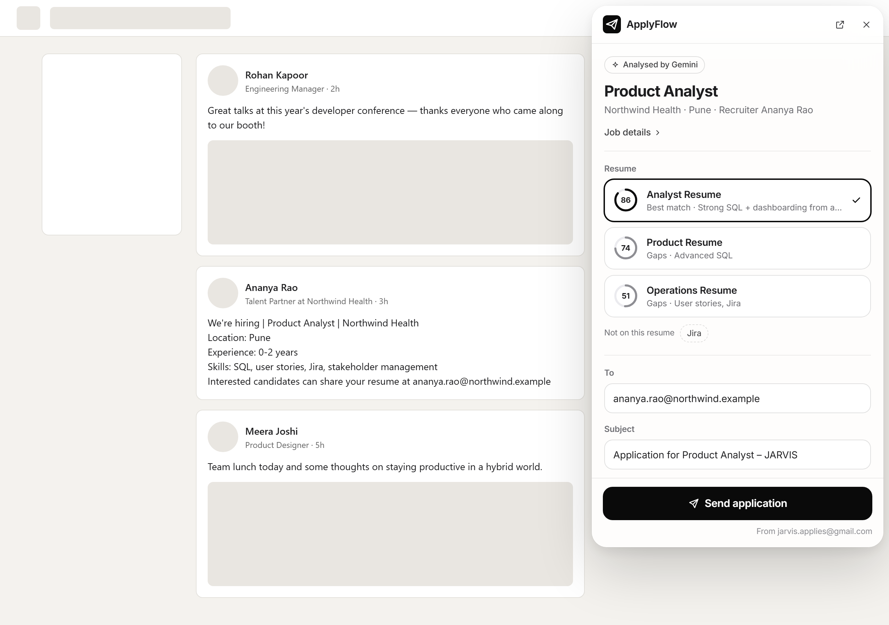

<p align="center">
  
</p>

<h1 align="center">ApplyFlow AI</h1>

<p align="center">
  <b>Turn LinkedIn hiring posts into polished, personalised job applications in seconds.</b><br>
  Chrome extension · Node.js · Groq + Google Gemini · Gmail API
</p>

<p align="center">
  
</p>

<p align="center">
  🎨 <b><a href="SHOWCASE.md">See the full product showcase →</a></b> every screen, light and dark mode, and the design system
</p>

---

Many good jobs on LinkedIn are posted as ordinary feed posts: *"We're hiring, send your resume
to …"*. Applying to each one means copying details, choosing a resume, writing an email and
attaching a PDF, which takes 10–15 minutes every time.

**ApplyFlow AI does it in about 4 seconds, and you stay in control.**

- 🔍 **Detects hiring posts** automatically while you scroll your feed
- 🧠 **Extracts the job details** (role, company, recruiter, contact email, experience) with AI
- 📄 **Picks your best-matching resume** from your library, with a match score
- ✍️ **Drafts a personalised email** in *your* writing style
- 📤 **Sends from your own Gmail** with the PDF attached, but only after you click **Send → Confirm**
- 📊 **Tracks every application** and warns you before you apply twice

> 📘 Read the **[Product Requirements Document (PRD.md)](PRD.md)** for the full story: the problem,
> goals, requirements, architecture and the decisions behind it.
>
> 🎨 Read the **[Product Showcase (SHOWCASE.md)](SHOWCASE.md)** to see what the final version looks like.
>
> 🧪 **Want to try it?** Follow **[TESTING.md](TESTING.md)**: one-click setup for Windows and Mac, about 15 minutes.

## How it works

```
LinkedIn feed  ─▶ content.js detects the post → "Hiring post detected" card   (instant, no AI)
Click the card ─▶ /api/analyze-job ─▶ AI job summary: role, company, fresher/experienced,
                  skills, requirements, where to apply                             (~1-2s)
"Generate application" ─▶ /prepare ─▶ ONE AI call: resume match + email           (~2-3s)
Send → Confirm ─▶ /send ─▶ Gmail API (email + PDF resume attached)
```
Everything happens on the LinkedIn page. "↗" in the window opens the full Review page if you want more detail.

| Layer | Tech |
|---|---|
| Browser | Chrome Extension, Manifest V3 (vanilla JS/CSS, Inter font) |
| Backend | Node.js, Express 5, Multer, pdf-parse |
| AI | **Groq** (`gpt-oss-120b` → `gpt-oss-20b`) first, **Google Gemini** as backup — automatic fallback, request racing, retries |
| Email | Gmail API, OAuth 2.0 + PKCE, `gmail.send` scope only |
| Storage | Local JSON files in `backend/data/` (never committed) |

### Highlights
- **Fast:** match + email in one AI call on Groq — drafts in **~2–3 s** (from 21.6 s in V1).
- **Resilient:** two independent AI providers. If a model is overloaded, rate-limited or slow, the next one takes over automatically; a slow model is "raced" against a backup after 5 s.
- **Private:** API keys, resumes and your Gmail token stay on your computer. The backend only listens on `127.0.0.1` and refuses requests from websites.
- **Safe:** LinkedIn posts are treated as untrusted input (prompt-injection defence + output validation).

---

## 1. Daily use

**Start the backend** (keep this window open while you use LinkedIn):
```powershell
cd backend
npm.cmd start
```
You should see `ApplyFlow AI backend running at http://127.0.0.1:3000`.

Then just browse your LinkedIn feed:
1. A **"Hiring post detected"** card appears top-right → click it.
2. The window shows a **job summary** (role, company, fresher/experienced, skills, requirements).
3. Click **Generate application** → best resume (with match score) + drafted email — edit anything.
4. **Send application** → **Confirm** (nothing is sent until you confirm).

Posts you only scroll past never use the AI, so the free AI quota lasts much longer.

Toolbar icon → **Open Dashboard** for: applications history, resume library, settings.

## 2. First-time setup

### a) Backend
```powershell
cd backend
npm.cmd install
```
Copy `backend/.env.example` to `backend/.env` and fill it in:
```
GROQ_API_KEY=your-key-from-console.groq.com      # main AI (fast, free tier)
GEMINI_API_KEY=your-key-from-aistudio.google.com # backup AI
PORT=3000
# Added in step (c):
GOOGLE_CLIENT_ID=
GOOGLE_CLIENT_SECRET=
```

### b) Chrome extension
1. Open `chrome://extensions` and turn on **Developer mode**.
2. **Load unpacked** → choose the `extension` folder.
3. After any code change: click the reload ↻ icon on the ApplyFlow card, then refresh LinkedIn.

### c) Gmail (one-time, ~10 minutes)
ApplyFlow asks Google only for permission to **send** email. It cannot read your inbox and never sees your password.

1. Go to <https://console.cloud.google.com/> → project dropdown → **New project** → name it `ApplyFlow AI` → Create.
2. **APIs & Services → Library** → search **Gmail API** → **Enable**.
3. **APIs & Services → OAuth consent screen** (may be called "Google Auth Platform"):
   - User type **External** → app name `ApplyFlow AI`, your email as support + developer contact.
   - **Audience / Test users** → **Add users** → add the Gmail address you will send from.
   - Leave the app in **Testing** mode (fine for personal use).
4. **APIs & Services → Credentials → Create credentials → OAuth client ID**:
   - Application type: **Desktop app** → name `ApplyFlow Desktop` → Create.
   - Copy the **Client ID** and **Client secret**.
5. Paste them into `backend/.env`:
   ```
   GOOGLE_CLIENT_ID=1234567890-abc...apps.googleusercontent.com
   GOOGLE_CLIENT_SECRET=GOCSPX-...
   ```
6. Restart the backend (Ctrl+C, then `npm.cmd start`).
7. Dashboard → **Settings** → **Connect Gmail** → choose your account.
   Google will warn *"Google hasn't verified this app"* — that's expected for your own Testing app:
   click **Continue**, and make sure the **Send email on your behalf** box is ticked.

> **Note:** In Testing mode Google expires the connection after **7 days**. When sending says
> "Gmail access expired", just click **Connect Gmail** again.

### d) Make the emails sound like you (recommended, ~3 minutes)
Your AI assistant (ChatGPT, Claude, Gemini) already knows you from months of chats — ApplyFlow can use that.
1. Dashboard → **Settings** → **About me** → **Copy the prompt**.
2. Paste it into your AI. It writes a career profile of you: education, projects in your own words,
   skills with honest levels, internships, how you like your emails, and a "never claim" list.
3. Paste the answer back, check it, and **Save settings**. ApplyFlow condenses it once into a short fact
   sheet (you can preview it). It stays on your computer.
4. Optional: edit the **Email skeleton** — your own wording with `[blanks]`. The AI keeps your words and only
   fills the blanks for each job, so every email sounds like you and the AI has little room to invent things.

In blind tests against the user's favourite ChatGPT emails, this was the change that mattered: the AI needs
your context and your voice, not a cleverer prompt.

---

## 3. Project structure
```
backend/
  server.js            API routes + security (origin/host checks, rate limit)
  lib/gemini.js        Gemini requests + error codes
  lib/ai.js            AI prompts + output validation (job, resume, match, email)
  lib/ai-router.js     provider order (Groq → Gemini), racing, fallback, retries
  lib/groq.js          Groq requests (strict JSON, low reasoning effort)
  lib/resumes.js       PDF upload/validation/text extraction, resume library
  lib/applications.js  application tracking + duplicate detection
  lib/gmail.js         OAuth 2.0 (PKCE) + email builder + sending
  lib/settings.js      your name/signature/writing preferences, About me, email skeleton
  lib/about-me.js      "About me" import prompt + condensing it into a compact fact sheet
  lib/store.js         safe JSON storage
  data/                YOUR DATA (resumes, applications, Gmail token) — never commit/share
  tests/               npm.cmd test
extension/
  manifest.json        Manifest V3
  content.js           LinkedIn detection + floating ApplyFlow window
  background.js        talks to the backend, caching, timeouts
  review.html/js/css   Review & Apply page
  dashboard.html/js/css Applications · Resumes · Settings
  popup.html/js/css    toolbar popup (status + manual import)
  common.js/css        shared helpers & styles
```

### Keeping the private ClaudeCode copy up to date
This project is also mirrored into the `applyflow-ai/` folder of a private repo. After committing
and pushing, run `.\sync-claudecode.ps1` from the project root. It uses the git remote named
`claudecode`.

### Quick check scripts (`backend/test-*.js`)
These standalone scripts came from the first day of the project, before the app was built. They
were used to check that the API keys worked and to compare AI providers. They aren't part of the
app and aren't needed to run it.

| Script | What it does |
|---|---|
| `test-gemini.js` | Sends one "Hello" prompt to Gemini to confirm `GEMINI_API_KEY` works. |
| `test-job-analysis.js` | Runs a sample LinkedIn post through job analysis. |
| `test-openai.js` | Sends one "Hello" prompt to OpenAI. An early experiment. OpenAI required buying credits before the first request would work, so ApplyFlow was built on **Gemini**, whose API has a free tier. The app never calls OpenAI. Kept only for reference, and needs `OPENAI_API_KEY` if you run it. |

Run one with `node test-gemini.js` from the `backend` folder. The real automated tests are in
`tests/` (`npm.cmd test`).

## 4. Configuration (`backend/.env`)
| Variable | Purpose |
|---|---|
| `GROQ_API_KEY` | Main AI. Free key from [console.groq.com](https://console.groq.com/keys). |
| `GEMINI_API_KEY` | Backup AI. Google AI Studio key. At least one of the two keys is required. |
| `AI_PROVIDERS` | Optional. Provider order, default `groq,gemini` (or `gemini` if there's no Groq key). |
| `GROQ_MODELS_DRAFT` / `_FAST` / `_SMART` | Optional. Groq models per task, default `openai/gpt-oss-120b,openai/gpt-oss-20b`. |
| `GROQ_MODELS_FAST` / `GROQ_MODELS_MATCH` | Optional. Reading posts and scoring resumes use the small model first (default `openai/gpt-oss-20b,openai/gpt-oss-120b`) so the big model's per-minute budget is free for writing the email. |
| `GROQ_REASONING_EFFORT` | Optional. `low` (default, ~2x faster) / `medium` / `high`. Resume analysis uses `medium` (`GROQ_REASONING_EFFORT_SMART`). |
| `GOOGLE_CLIENT_ID` / `GOOGLE_CLIENT_SECRET` | Gmail sending (see 2c). |
| `GEMINI_MODELS_FAST` | Optional. Comma list for job analysis, tried in order. Default `gemini-3.5-flash-lite,gemini-3.1-flash-lite,gemini-3.5-flash` |
| `GEMINI_MODELS_SMART` | Optional. Comma list for one-time resume analysis. Default `gemini-3.5-flash,gemini-3.5-flash-lite,gemini-3.1-flash-lite` |
| `GEMINI_MODELS_DRAFT` | Optional. Comma list for match + email drafting (fastest first). Default `gemini-3.5-flash-lite,gemini-3.1-flash-lite,gemini-3.5-flash` |
| `GEMINI_DRAFT_TIMEOUT_MS` | Optional. Per-model timeout while drafting, default 12000. |
| `AI_HEDGE_MS` | Optional. If a model hasn't answered after this many ms, the next model is asked in parallel and the first answer wins (post reading + drafting only). Default 5000. |
| `GEMINI_TIMEOUT_MS` | Optional. Per-model timeout, default 20000. |
| `AI_RETRY_ROUNDS` | Optional. If *every* model fails for a temporary reason (busy, rate-limited, timed out), try the whole list again this many times. Default 1. Set 0 to turn off. |
| `AI_RETRY_DELAY_MS` | Optional. Pause before a retry round, default 2000. |
| `AI_RETRY_BUDGET_MS` | Optional. A new retry round only starts if the request is still within this total time, default 30000. |
| `ALLOWED_EXTENSION_ID` | Optional hardening: only your extension (ID from chrome://extensions) may call the API. |

## 5. Troubleshooting
| Problem | Fix |
|---|---|
| Popup says *"AI analysis unavailable"* | Look at the backend window. `GEMINI_OVERLOADED 503` / `TIMEOUT` = Google is busy; the backend already tried backups. Retry later or add models to `GEMINI_MODELS_FAST`. |
| *"ApplyFlow backend is not running"* | Start it with `npm.cmd start` in `backend`. |
| `Port 3000 is already in use` | An old backend is still running. Find it: `netstat -ano \| findstr :3000` → note the last number (PID) → `Stop-Process -Id <PID>`. |
| No popup on LinkedIn | Reload the extension, then refresh LinkedIn. Open DevTools (F12) → Console and look for `ApplyFlow AI:` lines. |
| *"ApplyFlow AI was updated. Refresh this LinkedIn page."* | Exactly that — the extension was reloaded while LinkedIn was open. |
| Resume "Analysis failed" | Scanned/image PDFs have no text — export a text-based PDF. Or click **Re-analyse** if the AI was busy. |
| *"Gmail access expired"* | Dashboard → Settings → Connect Gmail again (7-day limit in Testing mode). |
| `npm` blocked in PowerShell | Use `npm.cmd` instead of `npm`. |

## 6. Security & privacy
- API keys live only in `backend/.env` — never in the extension.
- The backend listens on `127.0.0.1` only and refuses requests from websites (only the extension may call it).
- Resumes, applications and the Gmail token are stored only on this computer in `backend/data/`.
- LinkedIn posts and resumes are treated as untrusted text; the AI is told to ignore instructions inside them and all AI output is validated.
- Nothing is ever emailed without you clicking **Send Application** and confirming.

## 7. Before publishing to the Chrome Web Store (future)
This version is a **personal local tool**. A public release needs a hosted backend with user
accounts, per-user data isolation, rate limiting and its own paid AI plan (Groq's free tier allows ~2 drafts/minute per model) — never ship a shared API
key inside the extension. Gmail's `gmail.send` scope also requires Google's app verification.
