

  

<h1 align="center">ApplyFlow AI — Product Showcase</h1>

  <b>What the final version (v2.2) looks like, screen by screen.</b> 
  All screenshots use sample data (candidate "JARVIS", fictional companies and <code>.example</code> emails). No real account is shown.

---

## Contents
1. [The journey in 30 seconds](#1-the-journey-in-30-seconds)
2. [On LinkedIn: the floating window](#2-on-linkedin-the-floating-window)
3. [Sending safely: Send → Confirm](#3-sending-safely-send--confirm)
4. [Light and dark mode](#4-light-and-dark-mode)
5. [Toolbar popup](#5-toolbar-popup)
6. [Dashboard](#6-dashboard)
7. [Full Review page](#7-full-review-page)
8. [Design system](#8-design-system)
9. [How the design evolved](#9-how-the-design-evolved)

---

## 1. The journey in 30 seconds

| Step | What you see |
|---|---|
| **1. Scroll** | You browse your LinkedIn feed as normal. |
| **2. Detect** | A small *"Hiring post detected"* card slides in at the top-right. |
| **3. Draft** | Click it. In about 4 seconds the floating window shows the job, your best resume and a ready-to-send email. |
| **4. Send** | Edit anything, then click **Send application → Confirm**. The email goes out from your Gmail with your PDF attached. |
| **5. Track** | The application appears in the Dashboard as *Applied*. |

---

## 2. On LinkedIn: the floating window

### Hiring post detected
ApplyFlow reads posts as you scroll. When one is a real hiring post, a compact card appears in the
corner. It doesn't block the feed and doesn't use any AI quota until you click **Draft**.

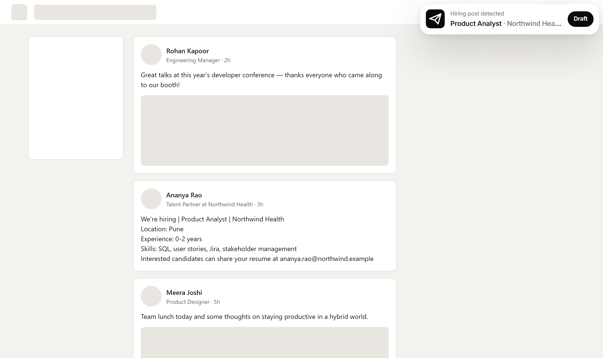

### Job, resume match and email in one place
Clicking the card opens a **floating, draggable window** right on the LinkedIn page, with no new tab.

- **Job summary** extracted by Gemini: title, company, location and recruiter.
- **Resume match:** every resume in your library gets a score ring (86 / 74 / 51). The best one is preselected and shows why it fits; the others show their gaps.
- **"Not on this resume"** chips list the skills the post asks for that your resume doesn't mention.
- **To / Subject** are pre-filled from the post, and everything is editable.

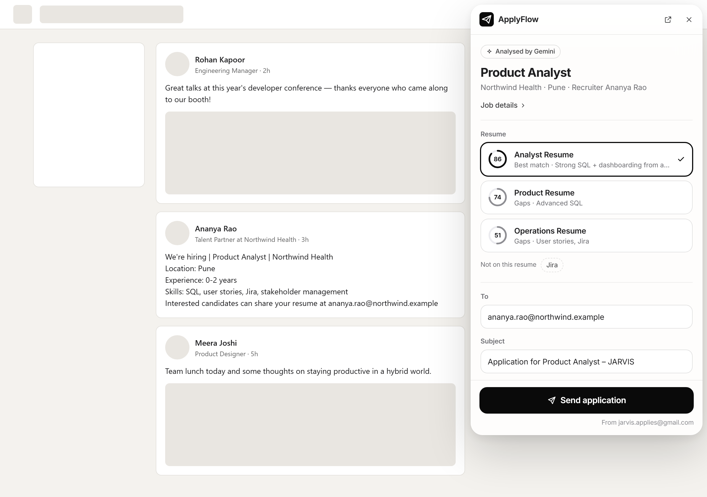

### The drafted email
Scroll down inside the window to see the email. It's written in **your** style: the user saves an
example email they like, and every draft follows its tone and structure (~200 words, warm, ending
with "Warm regards, Name | phone"). **Rewrite** asks Gemini for a fresh version.

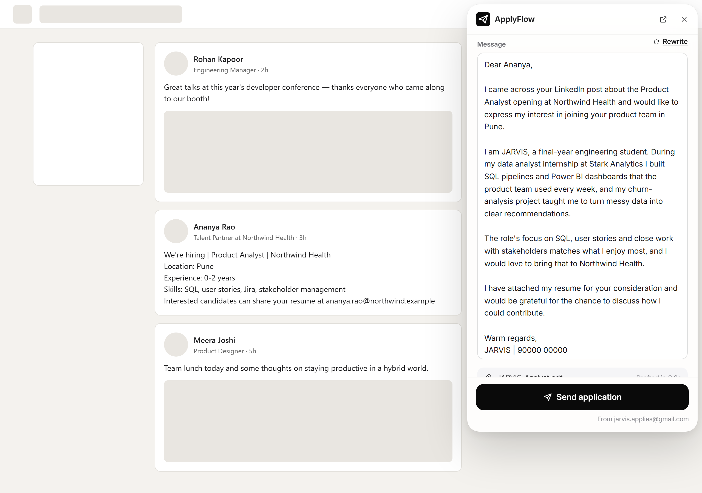

---

## 3. Sending safely: Send → Confirm

Nothing is ever sent by accident. The first click turns the button into an explicit
**"Confirm — send to *recruiter's address*"**, which you can cancel. If you don't confirm within a
few seconds, it resets automatically.

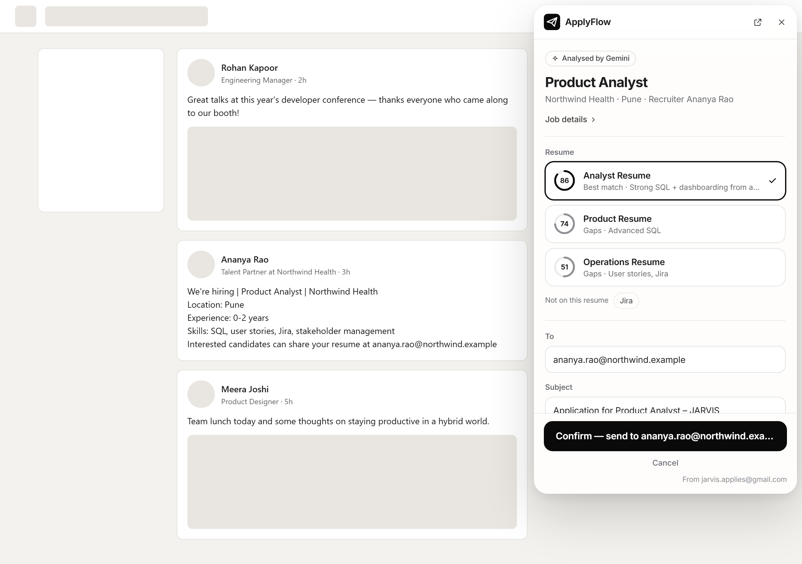

After confirming, the email is sent through the Gmail API with the PDF attached. The window then
shows **Application sent**, and the post is tracked as *Applied*.

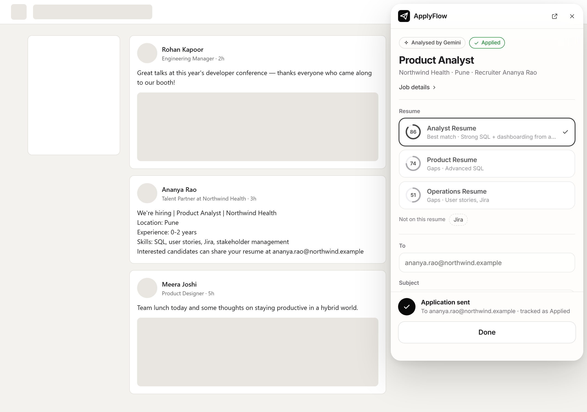

---

## 4. Light and dark mode

Every screen follows your system theme automatically. Dark mode isn't an inverted copy: it has its
own palette (true black background, raised `#1C1C1E` surfaces, brighter status colours).

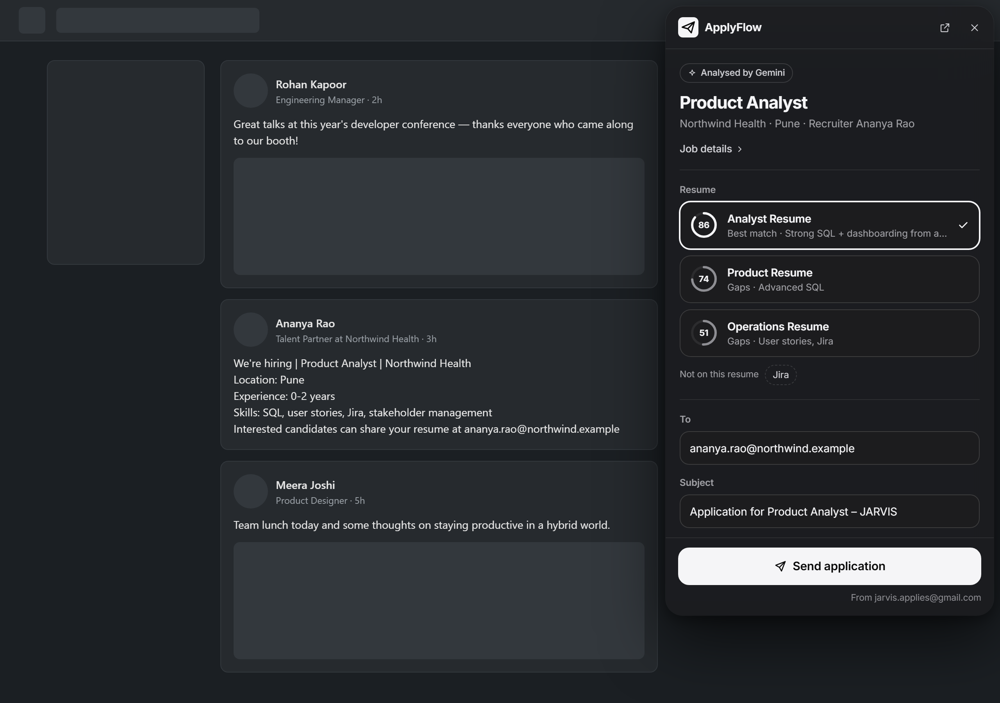

---

## 5. Toolbar popup

Click the ApplyFlow icon in Chrome's toolbar to see whether the backend is live, Gmail is connected,
and how many resumes and applications you have. **Analyse selected text** works on any website,
not just LinkedIn.

  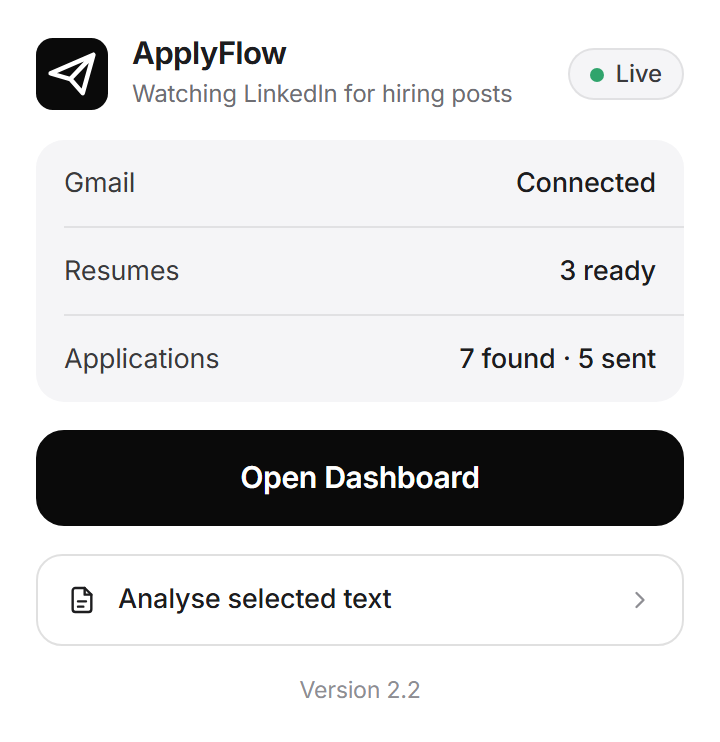
  &nbsp;&nbsp;
  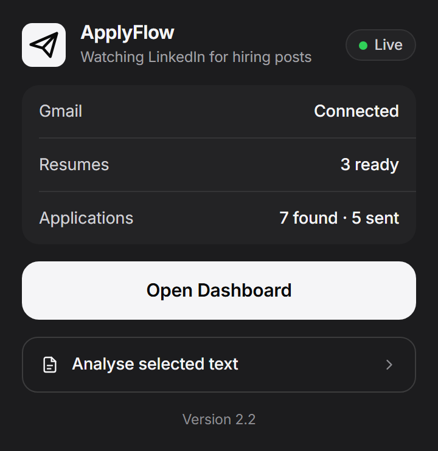

---

## 6. Dashboard

### Applications
Every hiring post ApplyFlow has found, with stats at the top, search and status filters, and an
inline status dropdown (*Detected → Analysed → Ready to Apply → Applied → Interview / Rejected / No Response*).

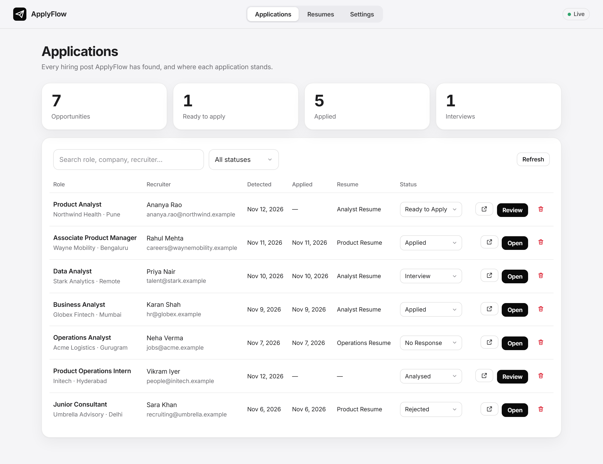

<b>Dark mode version</b>

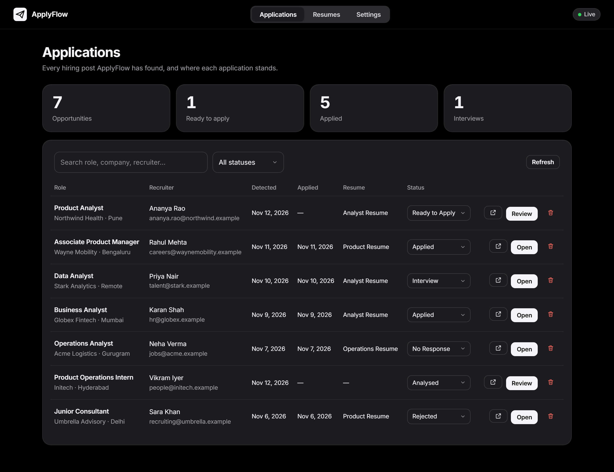

### Resumes
Upload PDF resumes once. Gemini reads each one and saves a profile (skills, experience, projects,
education, best-suited roles), which is what makes matching fast and accurate later. Files never
leave your computer.

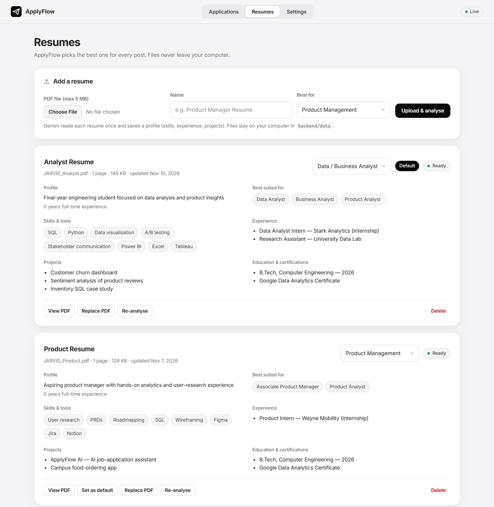

### Settings
- **Gmail:** connect or disconnect. ApplyFlow asks only for permission to *send*.
- **Gemini:** see which models are in use, in fallback order.
- **Your details & writing style:**
  - name, phone and LinkedIn URL,
  - the **example email** every draft imitates,
  - tone and writing preferences,
  - facts the email may use (e.g. notice period).

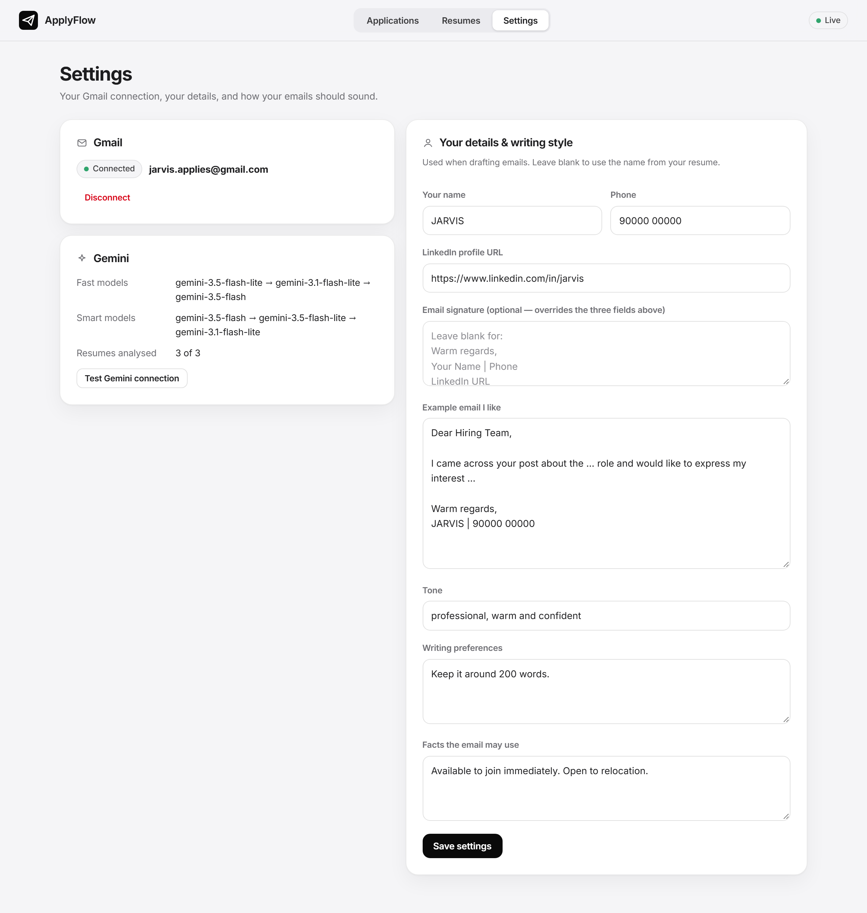

---

## 7. Full Review page

The **↗** button in the floating window opens a full-page view of the application. It has:
- the full job details,
- the resume ranking with reasons, relevant experience and gaps,
- the editable email with the PDF that will be attached,
- tracking: status and private notes.

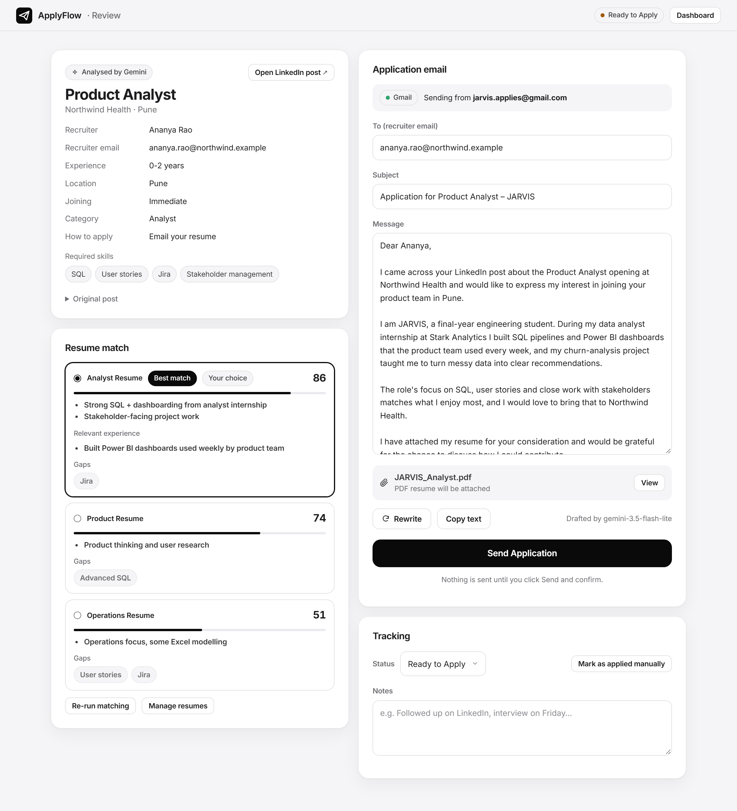

---

## 8. Design system

The v2.2 design is **monochrome and quiet**, inspired by Apple's interface style. Colour is used
only where it means something: green for live/connected/applied, red for destructive actions,
amber for "ready to apply".

| Token | Light | Dark | Used for |
|---|---|---|---|
| `--bg` | `#F5F5F7` | `#000000` | Page background |
| `--surface` | `#FFFFFF` | `#1C1C1E` | Cards, windows |
| `--text` | `#1D1D1F` | `#F5F5F7` | Primary text |
| `--muted` | `#6E6E73` | `#A1A1A6` | Secondary text |
| `--ink` | `#0A0A0A` | `#F5F5F7` | Primary buttons (black in light, white in dark) |
| `--ok` | `#248A3D` | `#30D158` | Live, connected, applied |
| `--danger` | `#D70015` | `#FF6961` | Delete, disconnect |
| `--warn` | `#A05A00` | `#FFB340` | Ready to apply |
| `--radius` | `18px` | `18px` | Cards and windows |

- **Typography:** [Inter](https://rsms.me/inter/) (variable font, bundled with the extension so it looks the same on every machine), with tight letter-spacing on headings.
- **Icon:** a white paper plane on a black rounded square ("squircle"), standing for *send*. Rendered as PNG at 16, 32, 48 and 128 px from a single SVG.
- **Iconography:** one hand-drawn line-icon set (`extension/icons.js`) shared by every screen.
- **Score rings:** match scores are drawn as rings rather than coloured badges, so the UI stays monochrome.
- **Isolation:** the LinkedIn window lives in a **Shadow DOM**, so LinkedIn's CSS can't break it and ApplyFlow's CSS can't break LinkedIn.

---

## 9. How the design evolved

| Version | UI |
|---|---|
| **V1** | Functional first: a popup card on LinkedIn that opened a separate **Review tab** for every application. |
| **v2.1** | Everything moved **onto the LinkedIn page** in a side panel. Black + electric-indigo theme. Drafting went from 21.6 s to 3.9 s. |
| **v2.2** *(final)* | Full **monochrome, Apple-like redesign** with automatic light/dark mode, the bundled Inter font and the new paper-plane icon. The side drawer became a **floating, draggable window**, so the feed stays visible while you apply. |

---

  <a href="README.md">README</a> · <a href="PRD.md">Product Requirements Document</a>

